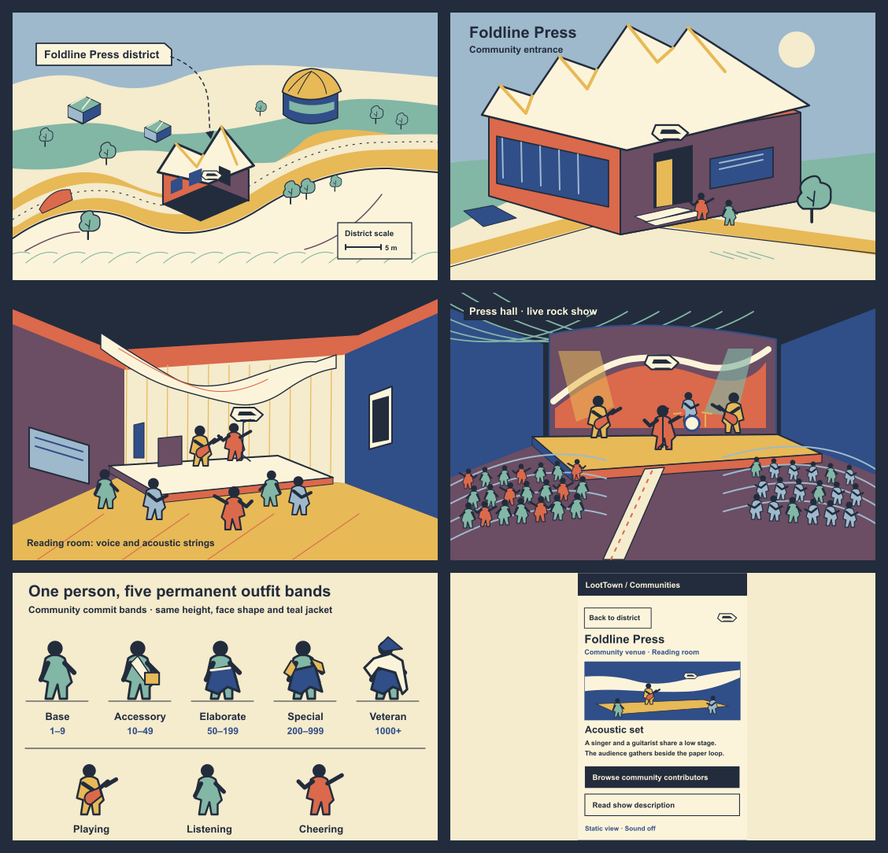

# Foldline Press

**LootTown art direction v0.1 · Proposed for review by D2Diego**

Foldline Press is a fictional community of printmakers. Seen from the street, the cream roof rises and falls like folded paper. Inside, a loop of unprinted stock hangs over the small acoustic set. At concert scale the loop becomes a broad two-color print behind the band. Follow the cream printer’s slug with its black inset and clipped corner through the three settings. It remains readable without the venue colors.

| Source drawing | What to review |
| --- | --- |
| [District](01-district.svg) | Select the press by its roof and slug among a greenhouse and round hall. Each building represents one community. The 5 m bar applies along the illustrated route near the press. |
| [Entrance](02-entrance.svg) | The oversized upper folds shelter a dark door with a cream slug above it. The light path meets the threshold from the right. |
| [Reading room](03-reading-room.svg) | A singer and guitarist share a low platform. Voices stay near the listeners. A quiet perimeter route leaves through the bright door on the right. |
| [Concert hall](04-press-hall.svg) | A drummer, vocalist and two guitarists perform behind the full-width print. The central light aisle keeps a continuous sightline to the stage. |
| [People and bands](05-people.svg) | One body and stable jacket color carry five clothing changes. A separate pose row distinguishes playing, listening and cheering. |
| [Mobile frame](06-phone.svg) | A 360 × 568 design uses a district return, a short static crop, a show description and two large controls. [Read the text equivalent](fallback.md). |

## Space, scale and material

Work in metres with Y up. Design structures on a 1 m grid and snap props to 0.25 m. Use a 1.70 m standing reference, a minimum 2.1 m clear pedestrian door, a 1.5 m clear circulation path in the reading room and a 2.4 m centre aisle in the hall. These are art blockout dimensions. Accessibility and building compliance for a physical venue would require separate design work.

Use a fixed three-quarter orthographic view for district selection, approximately 32° above the street. Keep north at the top of the map. The selected venue reserves about a quarter of a desktop frame. Move to an eye-level 1.55 m view at the threshold. For the 10 × 8 m reading room, use an approximately 50° horizontal field of view from the back third of the room. A 4 × 2 m, 0.25 m-high stage leaves the two performers the largest readable shapes. In the 32 × 22 m concert room, raise the camera to a 3.5 m gallery landing with a 62° horizontal field of view. Place the four performers across a 12 × 6 m stage with a 0.8 m deck. Silhouettes, props and camera placement communicate distance. Keep an unobstructed path downstage in both rooms. The drawings use illustrative perspective.

| Material or paint | Value | Use |
| --- | --- | --- |
| Carbon ink | `#222C3C` | Silhouette contours, orientation lines, dark lettering |
| Paper, unprinted face | `#FCF4DA` | Community glyph, signs and light controls |
| Paper, reverse side | `#F5EBCD` | Warm wall fill and matte ground |
| Cobalt | `#304E88` | Quiet backstage walls and secondary text |
| Terracotta ink | `#DB694B` | Street facade and active stage backcloth |
| Brushed brass | `#E7B957` | Stage decks, road edges and instrument trim |
| Sea glass | `#82B6A5` | Glazing and an example stable coat color |

Use matte lime plaster, translucent roof glazing and thin rolled paper stock with dark inked edges. Reuse a few broad planes. In the reading room keep overhead light warm and even. In the large hall use two fixed side washes and keep the sign legible between them. Draw the rock rhythm with performer poses and the alternating direction of the printed ribbons. Leave the stage clearly readable in a frozen frame.

## Community scale and character identity

Every community owns one building in the world. The exterior and interior share its stable name, glyph and colors. The alternate large-room drawing tests the *same* community identity at a later venue scale. These alternatives occupy one district location. Repository links and names belong in the evidence interface. A person may appear in multiple communities with different attributed commit bands. Resolve one character per stable GitHub ID within each community across its linked repositories. Use a stable per-person color/secondary shape key and preserve it through camera, show and wardrobe changes. Example keys can pair teal with a split cuff, or ochre with a square cuff. A person card also prints the handle. Representation conveys membership, independent of live presence.

| Proposed unique eligible contributors | Category and show | Constant within this community |
| --- | --- | --- |
| 1–49 | Reading room, seated or standing listeners, acoustic duet | Name, slug, ink palette, district position |
| 50–299 | Print exchange, standing demonstration or small ensemble, broad task lighting and a horseshoe of listeners | Slug on lintel and stage, luminous paper roof |
| 300+ | Press hall, four-piece rock set, stepped seating and fixed side washes | Same slug and paper band, enlarged for the gallery |
| Confirmed complete zero | Retain the entrance and community directory entry. Use the label “No eligible contributors in this snapshot.” Keep show and seating empty. | Community name and sign |
| Unknown, stale or incomplete coverage | Use an unscaled printed facade and “Contributor count unavailable” with coverage details. Keep the last verified venue visibly dated when supplied. | Community name and sign |

All venue cutoffs and empty/unknown choices above are **proposals**. Only a confirmed, complete snapshot can establish zero. Use distinct eligible contributors as defined by the upstream attribution policy. Do not size from repository count, page length, amount of funding or activity frequency. The existing synthetic fixture ranges from 213 to 574 people per community, so it exercises the proposed exchange and hall ranges. Use separate illustrative snapshots for the small, zero and unknown states. The fixture has 40 venues and 15,866 memberships. Those totals describe input data, not simultaneous visible people or a rendering benchmark.

Approved per-community commit bands are 1–9 complete base outfit, 10–49 accessory, 50–199 elaborate outfit, 200–999 special details or posture, and 1000+ veteran appearance. The sheet adds a pouch, pleated apron, armor-free bound shoulders and a long collar with a cap. Choose an individual scale once within roughly ±5% of 1.70 m, then keep stature consistent across bands. Keep comparable head proportions and an intact base outfit. Clothing additions retain the same body and meaningful identity feature. Preserve earned bands through inactivity. Unknown attribution receives a textual “Commit band unavailable” reading alongside the stable identity, without a tier assignment. Contribution tiers describe participation.

## Controls, mobile and motion

Use normal labelled links or buttons for world selection, scene entry, return and contributor profiles in the React layer. Tab order follows world directory, selected community, enter, show description, contributor list, return. On entry focus the venue heading. On return restore focus to the selected community. Keep the label and shape visible on keyboard focus, including at 200% zoom.

At 360 px crop the environment to a short horizontal stage strip, keeping the stage mark or community name above the fold. Place controls outside the artwork, at least 44 px high. The fallback document can be read with keyboard or a screen reader through plain Markdown links and headings. The two control studies in the SVG are illustrations. Production controls belong in the DOM.

The static format carries scene, sound and participation information without requiring WebGL, JavaScript or audio. Reduced motion selects fixed cameras and a still pose, with no auto-pan, camera tween, parallax, strobing or crowd bouncing. Sound starts off. Use a user-initiated sound control in the product and keep the show description available while muted.

Measured sRGB relative-luminance ratios for the opaque label pairs in these drawings are 12.78:1 for carbon on cream, 11.82:1 for carbon on reverse paper, 7.43:1 for cobalt on cream, 7.68:1 for carbon on brass, and 6.87:1 for carbon on the `#9EB9CC` sky. These exceed 4.5:1 for normal text. The slug’s light face and dark inset also provide a two-tone boundary against either class of background. Accent colors in the illustrations do not substitute for text labels or focus indicators.

## Asset handoff

The editable source and provenance for each drawing are in [the asset register](assets.json). The composite preview is rasterized from those exact SVGs. Sources use original paths, system sans-serif and no external media. Each file is a static vector with an accessible title and description. SVG groups and symbols can be edited independently.

For a future 3D kit, propose names such as `venue_foldline_reading_shell_v01.glb`, `prop_foldline_slug_v01.glb` and `person_common_v01.glb`. GLB units are metres and the floor-origin is centred at the entrance or feet. Export consistently facing +Z. Put the skeleton beneath `root` with `hips`, `spine`, `neck`, `head` and mirrored `.L` / `.R` limbs. Bind clothing overlays to the shared skeleton. Proposed clip IDs are `idle_listen`, `clap_soft`, `cheer_up`, `play_strings`, `play_drums` and `pose_still`. Each animation should return cleanly to its start pose or declare itself one-shot. Include a still poster frame. Choose crowd LOD and animation budgets after measuring target phones.

For each new GLB or texture, record ID, file, version, author, source, license, credit, modifications, units, pivot, rig, clips, LOD, triangle and texture budgets, plus the tools used to inspect the file. The supplied concept files have no rig, animation or textures.

## Review record

**v0.1 · November 21, 2026 · awaiting review.** D2Diego is the reviewer named on the issue. Product signoff and a winning bounty entry have not been recorded for this concept. Whether 50 and 300 are useful thresholds, how to show the last confirmed venue after coverage expires, how to assign repeatable personal shape keys, and which mobile devices bound the 3D budget remain open decisions. The first review choice is whether a community with a stale snapshot should retain a dated room or show only the neutral exterior.

The brief was checked against the [issue scope](https://github.com/devloot-xyz/LootTown/issues/2), [product](https://github.com/devloot-xyz/LootTown/blob/main/docs/product.md), [architecture](https://github.com/devloot-xyz/LootTown/blob/main/docs/architecture.md), [contract](https://github.com/devloot-xyz/LootTown/blob/main/docs/contracts.md), [fixture](https://github.com/devloot-xyz/LootTown/blob/main/docs/fixture.md) and [contribution instructions](https://github.com/devloot-xyz/LootTown/blob/main/CONTRIBUTING.md).
