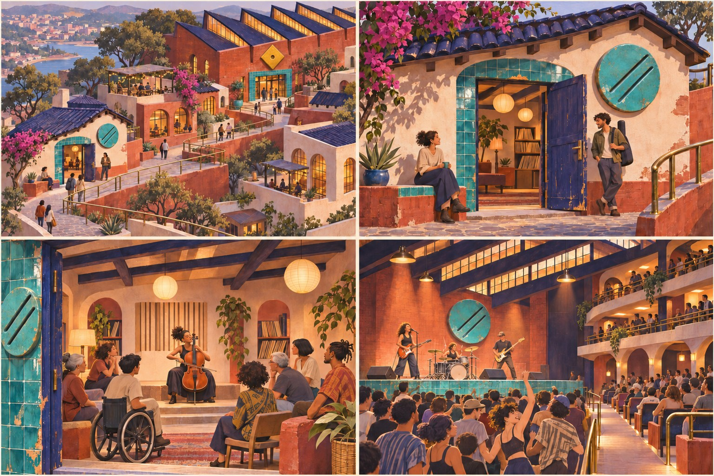
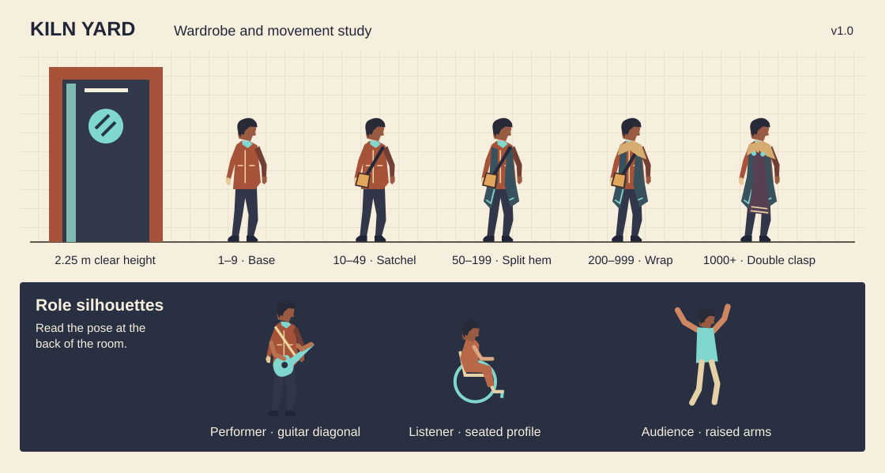

# Kiln Yard

**Environment and character direction v1.0 · proposed for review in [LootTown #2](https://github.com/devloot-xyz/LootTown/issues/2)**

A neighbor walking home can hear a cello through an open door. Farther up the same lane, a roof monitor glows over a rock show. The doorways are the same height. The span between the walls tells you which room you are about to enter.

In the upper-left map, find the round, double-cut tile above the door downhill. The gold diamond farther up the lane belongs to a neighbor. The upper-right view approaches the round-tile door and the lower-left view steps inside it. The lower-right painting imagines that same community years later, carrying its tile into a concert hall.

## Finding the door again

Give each community a fired-clay maker's tile. Our example has a turquoise disc with two parallel cuts. Mount it over the street entrance, repeat it on the stage wall, and use its flat pattern beside the community name in the venue directory. Its silhouette and incisions survive a grayscale print. Resolve collisions in the same neighborhood by changing the cut pattern and displaying the name on selection. Keep the community's tile, map anchor and entry orientation when it grows. Linked repositories share the venue.

Build on a 0.5 m snapping grid. Door clearance is 1.5 m wide by 2.25 m high, a bench seat is 0.45 m high, and circulation beside the audience is at least 1.5 m wide. Repeat a 0.25 m glazed tile course at the threshold and stage edge. Above head height, change roof spans and galleries to make the scale legible. At eye level, keep brick courses, handles and benches the same size.

| Proposed venue | Distinct eligible contributors, with complete coverage | Kit, show and audience cue |
| --- | ---: | --- |
| Listening room | 1–24 | 6 × 8 m room, one step and a single instrument. Listeners face inward around an open horseshoe. |
| Courtyard | 25–119 | 14 × 18 m court, two covered edges and a level stage. A percussion duo trades a rhythm across the court. A group at the far edge answers by clapping. |
| Assembly hall | 120–399 | 22 × 32 m hall with one clerestory and a side gallery. A presenter turns the face of a large demonstration board. Audience heads turn in sequence down the benches. |
| Concert hall | 400+ | 36 × 48 m clear-span building with a raised bandstand and a cut-through aisle. A rock trio drives a visible drum beat. Clapping near the stage dissolves into gentle swaying toward the door. |

These cutoffs are design proposals. The committed 40-community fixture spans 213–574 members, so it exercises the last two interiors. Review the two smaller interiors against separate fictional counts of 1, 24, 25 and 119. A complete, confirmed zero gets an open, unoccupied vestibule with the maker's tile and a readable count of zero. With incomplete coverage or a failed refresh, show a neutral doorway, the community name and “Contributor count unavailable.” Preserve a dated previous view only if the UI can label it as a previous snapshot. A visible crowd is a sample of community characters. List the full eligible roster independently of the rendering budget.

## Camera, light and the small screen

| Shot | Desktop frame | Portrait frame or still |
| --- | --- | --- |
| Map | Orthographic three-quarter view, about 38° above the street. Keep the lane continuous across buildings. | Center the selected entrance with its tile and one neighboring doorway. Put the venue list below the view. |
| Threshold | Eye height 1.55 m, 40° vertical field of view. Frame the maker's tile, doorway and a person in one shot. | Show the whole door plus jamb. Place the enter button in the document below it. |
| Listening room | Stay by the edge of the horseshoe. Keep listener and performer in one plane with a visible route to one seat. | Frame the cellist, the nearest listener and the aisle. The caption names the show. |
| Concert | Move to the side gallery. Allow heads in the foreground to overlap the stage lip, keeping its three performers distinct. | Frame one side aisle, the stage and its tile. Use a separate crowd detail on request. |

Use clay for large warm masses, chalky limewash for lit faces, deep indigo for roofs and recesses, and glazed turquoise for touchpoints. Reserve sharp highlights for glazed edges and brass hardware. Light from windows and warm fixed practicals. Keep concert lamps steady. In the DOM, use chalk `#F7EFDE` on ink `#202537` for text, and turquoise `#80D7CD` on ink for focus. Give focus a dark outer ring on light backgrounds. Place labels on opaque surfaces, anchor them to the selected venue, and repeat every color cue with a name, outline or pattern.

At 360 CSS px, present one still at a time with a visible text heading and a minimum 44 × 44 CSS px action area. Tab through venue names, activate Enter, and return with Escape to the originating list item. With reduced motion, cut between static views and use held poses for each show. With WebGL unavailable, reuse the directory, stills, captions and contributor list in reading order. Keep audio opt-in. A silent visitor can see who is performing and what the audience is reacting to.

## People at street distance

Use a nominal 1.70 m character, with body variation within about 10%. Lock face, body silhouette, personal accent and marker motif to the contributor's stable ID. A person's community-specific commit band dresses that same body. Keep the entry outfit complete and the gaze at the same eye line. Use garment edges and negative space to carry progression at thumbnail scale.

| Approved attributed commits | Detail in the character key |
| --- | --- |
| 1–9 | Complete work jacket, trousers and boots. |
| 10–49 | A satchel breaks the outer hip silhouette. |
| 50–199 | A split overcoat adds an offset hem below the jacket. |
| 200–999 | A shoulder wrap creates a diagonal edge over the same coat. |
| 1000+ | A long kiln apron with a double ceramic clasp marks the veteran outfit. |

An unknown count retains the personal palette and a neutral jacket, with “Attribution unknown” in the profile. A verified zero can have a neutral outfit with its actual count. Preserve a known permanent band through inactivity. A cane, chair or seated pose is available at every band. Performer and audience roles can use the same body rig. Selection outlines the person and opens a named DOM profile. No status light implies live attendance.

## Handoff and review record

Export glTF 2.0 as GLB in meters, Y up, facing +Z. Give venue modules a floor-level pivot at the center of the entry threshold and avatars a pivot between the feet. Name files like `venue_listening_door_a.glb` and `person_base_a.glb`. Use one humanoid skeleton, `LT_Humanoid_v1`, rooted at `root` with a `hips` child. Use `_L` / `_R` for paired bones. Outfit meshes share the bind pose and skin weights. Bake transforms and keep locomotion in place. Start with clips `idle_watch`, `sit_listen`, `clap_loop`, `sway_loop` and `play_guitar_loop` with consistent loop endpoints. Define a still pose for each. No GLBs ship in this proposal.

For the first prototype, budget one shared 1024 px material atlas per venue kit, one 512 px atlas for outfits, and 2,000 triangles per near character. Use flat crowd cards beyond the first occupied rows. Record frame time, memory, draw calls and visible people on named desktop and mobile devices before accepting budgets. The fixture membership count is independent of these targets.

| Decision for the maintainer | State in v1.0 |
| --- | --- |
| Art direction, camera and entrance identity | Proposed for review by the issue maintainer. Record the approved version and review link here after sign-off. |
| Size boundaries and zero / unknown treatments | Compare four cutoff pairs, especially 399 / 400, in the DOM and static map before approval. |
| Mobile tile recognition | Review the 360 px crops in grayscale. Confirm both cuts survive beside the community label. |
| Rig, audience density and material budgets | Validate in a later prototype on a named mobile device. |

The [asset manifest](assets.md) records rights, source and production details. The [product rules](../../product.md) remain the authority for permanent avatar bands.
