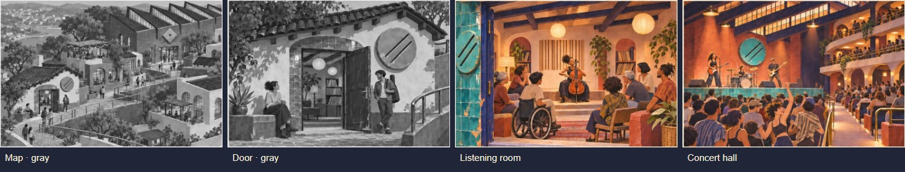

# Assets and review evidence

| File | Creator and source | Processing | Rights and attribution |
| --- | --- | --- | --- |
| [venues.jpg](venues.jpg) | Built-in OpenAI ImageGen from [the two prompts](production-notes.txt), beginning with text alone. The second pass used the first generated sheet. | Exported to JPEG at the original sheet dimensions for repository review. | Contributed under the [repository MIT license](../../../LICENSE) to the extent rights exist. Credit “LootTown contributors, Kiln Yard v1.0 (AI-assisted).” |
| [people.svg](people.svg) | Original paths and diagram authored directly in SVG for this proposal. The editable file is the source. | The same drawn figure is reused for all five outfits. Role studies use separate poses. | Contributed under the [repository MIT license](../../../LICENSE). Credit “LootTown contributors, Kiln Yard v1.0.” |
| [mobile-review.jpg](mobile-review.jpg) | Four CSS viewport crops of the environment sheet above. | Rendered in Chromium at 360 × 240 CSS px per view. The map and door use a grayscale filter. | Same source, credit and license as the environment sheet. |

Keep future asset records beside the art brief. Each record needs the asset ID and version, source file or immutable source URL, creator, license ID and license link, attribution text, modifications, exported file and approval link. For a GLB also record dimensions, pivot, triangle count, materials and textures, rig version and clip names. For an AI-generated asset record the tool, prompts and any reference inputs. Add a separate row for each external dependency so a reviewer can trace it.

## Review evidence

- The construction sheet was rendered in Chromium at 1120 × 600. All five captions fit, the same base character keeps its eye line, and the doorway gives the lineup a scale reference.
- At 360 px per frame, the circular and diamond plaques separate the two venues in grayscale. Individual audience faces recede in the concert shot, while the side aisle and band still read. Use the roster for selecting an individual on a small screen.
- Relative luminance ratios are 13.29:1 for chalk text on ink and 9.06:1 for the turquoise focus color on ink. These values apply to the specified opaque UI colors.
- The synthetic fixture and domain suite passed all 24 tests. The repository's lint, typecheck and build commands also passed. This proposal ships artwork and documentation.
- Still-image review covers composition and color. Keyboard traversal, reduced-motion switching, actual mobile GPU budgets and screen-reader announcements need a later interactive implementation.
