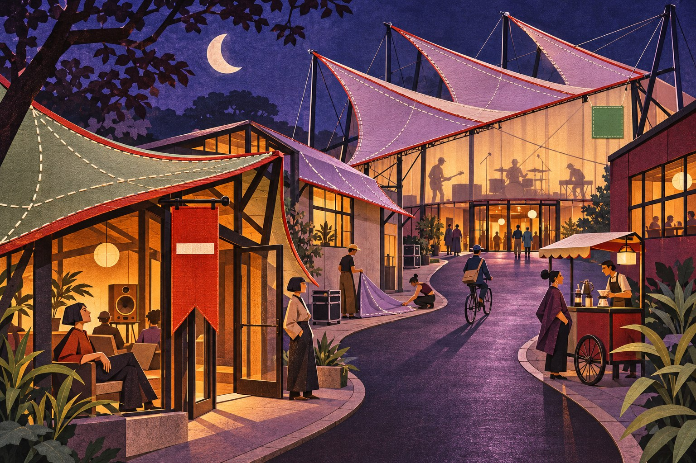
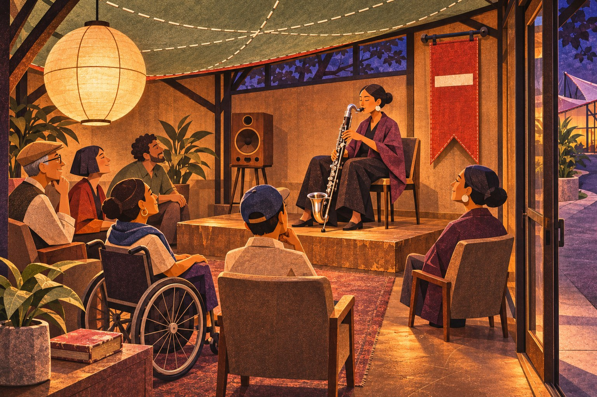
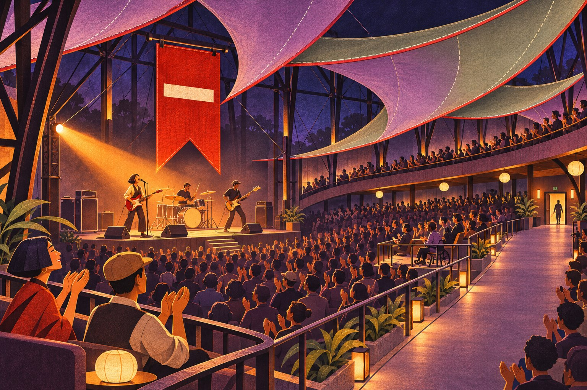
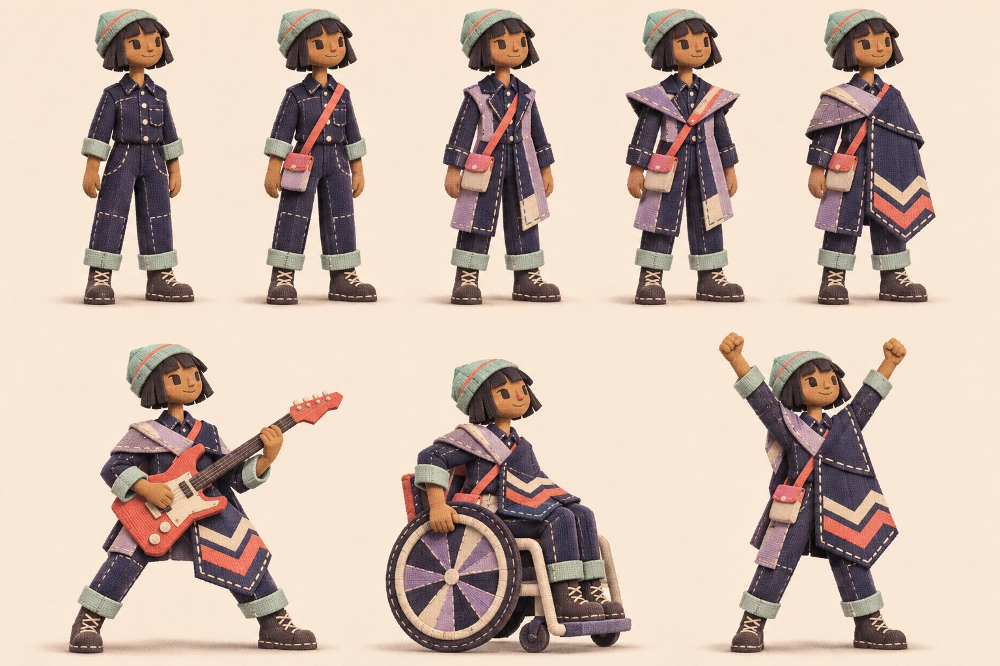

# Night Loom

**Proposed visual direction v1.0 for [LootTown #2](https://github.com/devloot-xyz/LootTown/issues/2).**

Follow the red flag. On the street it fits between two doorposts. In a listening room it hangs beside one player. Years later it fills the space behind a rock band. A community can outgrow its first building and still feel like the place you know.

Open **[review.html](review.html)** from a local checkout for the keyboard-accessible plate viewer. It runs offline. On GitHub the images below can be opened individually.

| A listening booth | The same community at concert scale |
| --- | --- |
|  |  |

## A walk from the map to the stage

The painted street is the pedestrian's view. The [block plan](plan.svg) gives the artist a map camera, four addresses and the same route in plan. Each address belongs to one DevLoot community. A linked repository adds evidence about contributors at that address. An eligible person has one character per community, keyed by stable GitHub ID. People seated at a show represent contributors across time.

The listening booth sits on the bend. Two dark uprights and a single low sail make its outline recognizable before the flag is visible. The mint-square venue at the far end of the street is a different community. The large red-flag interior on this page is a later-size study of the booth's community. In either size, preserve the street address, the direction from which you enter, the flag cut and bar, and the accent colors. Add space behind the same threshold. Use a short community name beside the flag when two patterns would be difficult to distinguish.

**Build from the door outward.** One grid square is 0.5 m. Use a 1.5 × 2.25 m clear doorway, a 0.45 m seat height and a 1.5 m clear aisle from street to an integrated audience position. The small room has a 3.25 m roof crest. The concert house has a 12 m crest and a 9 m apron. The camera can see a doorpost and a person together in both rooms.

| Proposed venue | Complete, unique eligible count | Show and felt difference |
| --- | ---: | --- |
| Booth | 1–15 | One 5 × 7 m bay. A solo reed player takes a breath and the semicircle leans in. Everyone fits in one pool of light. |
| Court | 16–95 | A 12 × 16 m open court under two crossing sails. Two drummers trade phrases across the aisle. Listeners turn from left to right between phrases. |
| Loft | 96–383 | An 18 × 28 m weaving shed. A storyteller draws a long printed strip sideways across a lit frame. Seated rows follow the moving reveal. |
| Hall | 384+ | A 32 × 48 m house with three roof bays and a balcony. A rock trio plays under one enlarged community flag. People clap by the apron and sway along the outer rail. |

The thresholds are proposals for product review. Counting distinct eligible IDs in the committed 40-community fixture puts **20 communities in the loft and 20 in the hall**. The fixture covers 213–574 people per community. Review counts of 0, 1, 15, 16, 95 and 96 separately before approving the smaller venues.

With a complete count of zero, show the named address with its flag, neatly rolled sail and empty display rail. Show “0 eligible contributors.” Incomplete or unavailable coverage gets a standing doorway and a plain scrim with “Contributor count unavailable” beside the name. A dated, known previous scene may be presented as a previous snapshot. Allow selection of the community in every state. Count unique eligible people upstream of venue selection. The number of visible figures can be capped independently.

## Characters you can pick out in a crowd

Keep the same head, body proportions, personal palette and recurring trim across the five outfits. Allocate silhouettes and palettes deterministically from the stable person ID. Derive the outfit from their attributed commits within this community. Use a nominal 1.70 m body with roughly 10% variation. The first outfit is complete. A person using a chair can wear every outfit.

| Approved commit band | Thumbnail cue |
| --- | --- |
| 1–9 | Plain fitted indigo workwear and contrasting cuffs. |
| 10–49 | A diagonal strap ends in a satchel outside the hip. |
| 50–199 | A divided coat hem makes two distinct corners beside the knee. |
| 200–999 | A folded shoulder yoke widens the outline on one side. |
| 1000+ | A festival mantle adds a broad hanging plane and twin chevrons. |

When attribution is unknown, preserve the person's ID colors and accessible name and show “Attribution unknown” in the profile. A measured zero can display its actual count without awarding a band. Inactivity leaves a known band intact. Profile selection works from the full roster even when a distant crowd uses simplified figures.

## Camera, materials and fallback

- **Map and door.** Aim an orthographic camera from above the street bend. Descend to a 1.55 m doorway viewpoint with a 42° vertical field of view. Preserve the entry side through the cut. On a phone, frame the flag and its door together.
- **Booth and hall.** In the booth, hold the camera at a listener's shoulder. In the hall, move to the side balcony and use the aisle as a diagonal leading line to the trio. For a narrow view, preserve both the emblem and the main action. Letterbox an entire plate when a crop would remove either.
- **Material grammar.** Cloth takes broad matte color and a few heavy stitched diagonals. Steel ribs stay dark and thin. Warm light can pass through a back wall to show the outlines of instruments. Fixed practical lamps are amber. UI ink is `#191A2C`, paper `#F6F0DE`, and focus mint `#9FE0BF`. Reserve the cream bar and V-cut for the example community. Never depend on red/green distinction.
- **Input and access.** The review viewer has named links, arrow-key navigation and persistent focus indication. A future world should also offer a venue list with name, coverage and show, an Enter action, a roster, and an Escape path to the selecting control. Reduced motion uses a cut and a held pose. Audio starts on request. The static plates and their captions provide the visual path when WebGL is unavailable.

## Production handoff

Export GLB in metres, Y up, facing +Z. Set each building pivot at the center of its threshold and each standing character's pivot between the soles. Use a shared rig named `LT_Humanoid_v1` with `root` → `hips` and paired `_L` / `_R` bones. Use `venue_booth_canopy_a.glb`, `person_coat_split_a.glb` and similar descriptive filenames. Start with in-place clips `watch_idle`, `listen_seated`, `play_reed`, `play_guitar`, `clap_loop` and `sway_loop`. Give each clip an authored still pose. The chair is a separate aligned attachment.

Prototype with one 1024 px atlas for roof cloth, one 512 px outfit atlas, and up to 2,000 triangles for a near person. Use cutout cards behind the first rows and exclude occluded rows before animating. Measure on actual desktop and mobile devices before adopting a budget. The [production record](production.md) gives the asset register and review checks.

**Decision record.** Version 1.0 is proposed to the issue maintainer. Select or revise the canopy family, the 15/16, 95/96 and 383/384 boundaries, and the two coverage treatments. The five approved avatar bands follow the [product rules](../../product.md). The production budgets and actual device frame times need a future 3D prototype. Record the approved version and review link here when a decision is made.
