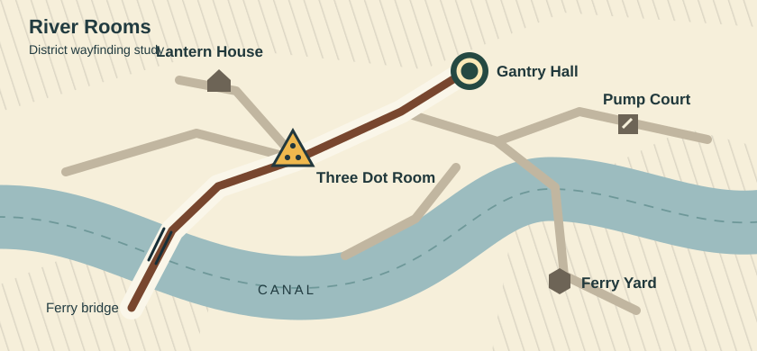
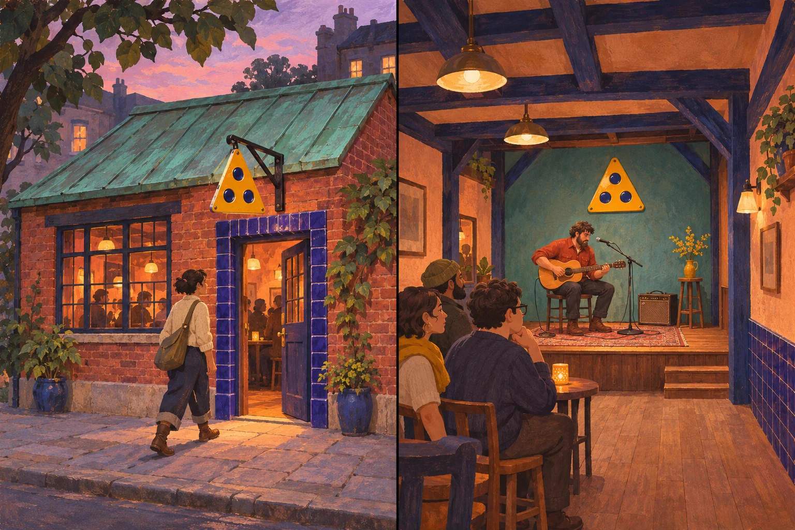
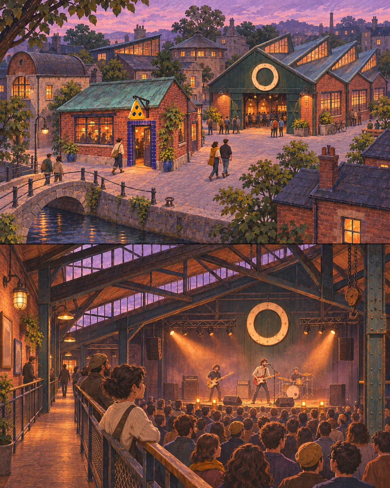
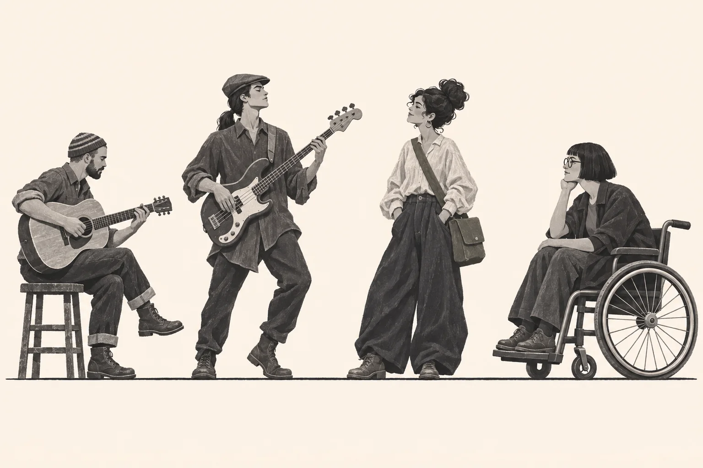
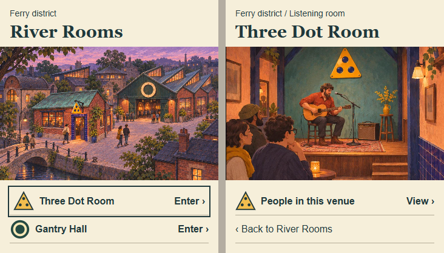

# River Rooms

Art direction candidate v1 for LootTown issue #2. A walk from the ferry bridge takes the player past a listening room and into a converted boat shed. A community keeps one address and one enamel sign. That sign appears on the map, over the door, and behind the performer.

The drawing is a five-community wayfinding study. In the 40-community fixture, group distant venues by district at the widest zoom. Selecting a district expands its venues in map order and in a parallel searchable list. A repository contributes evidence to its community. Adding a repository leaves the street plan intact.

### At the threshold

At Three Dot Room, the player's eye crosses a blue-tiled threshold before it finds the stool. Keep the stage low enough for performer and front-row listener to meet at eye level. One practical lamp picks out the guitar hand. The audience shifts weight, looks up, or taps a foot.

At Gantry Hall, three sawtooth roof bays identify the building from across the water. The cream ring faces the street and repeats above the backline. Sidestage amber light separates the bassist from the drums. Audience movement comes in small staggered groups. Leave the side aisle visibly open from the door to the rail. Building form and event belong to the community. An avatar's contribution band never assigns a stage role.

### Scale and camera

| View | Blockout | Framing cue |
| --- | --- | --- |
| World | 1 m grid, half-metre snapping for entrances, 2 m clear door height | Start with a fixed oblique overview, about 35° down. Keep the canal and bridge in frame while selecting the first room. |
| Listening room | 8 × 10 m footprint, 3 × 2 m rug, 0.18 m stage lip | A 40 mm full-frame equivalent from approximately 1.55 m eye height keeps both sign and stool in frame. Offer the same sightline seated. |
| Boat shed | 26 × 36 m floor, 12 × 7 m stage, 1.2 m stage height, 1.8 m clear side aisle | A 28 mm equivalent from the balcony establishes depth. The floor view pairs the ring with the drummer. Preserve a side view for selecting a front-row listener. |

Use oxidized copper on roof planes, blue glazed tile at the club door, dark timber around the small stage, and riveted steel at the hall. Place the highest light contrast at a door or performer. Keep distant façades in the violet midtones. Reserve the flat ink/paper pair (#20383B and #F6EFDA) for labels and navigation, where lighting stays constant.

### A person the player can find again

Start with a seven-head adult figure around 1.7 m standing and keep body variation within about 10%. At the club door, look for the high bun and broad strap across a light blouse. In the grayscale lineup, the same listener is third from the left. The other contours are a short knit cap, a flat cap with a low ponytail, and a blunt bob. Keep the head outline and base clothing value stable when adding accessories. Derive a stable accent pair and garment motif from identity. Preserve mobility equipment, body proportions and the player's selection when outfits change. Give each selectable character a visible name and accessible text label. Crowd animation portrays participation in a show.

| Approved community commits | Outfit treatment on the same satchel listener |
| --- | --- |
| 1–9 | Fully dressed, with plain shirt, jacket, trousers and shoes |
| 10–49 | Add the satchel over the same jacket |
| 50–199 | Panel the jacket sleeves, keeping the strap readable against the chest |
| 200–999 | Add stitched cuffs and a folded lapel |
| 1000+ | Keep the jacket silhouette and add a patterned lining visible at the collar |

Deduplicate linked repositories by stable GitHub ID within the community. A new visit or inactivity keeps the band. Unknown attribution displays “Contribution band unknown” with the person's normal identity accents.

### Venue sizes for product review

These are proposed art-test thresholds for distinct eligible contributors with complete coverage. In the committed fixture, 23 communities would use the workshop and 17 the concert shed. Test a separate 24→25 case and a 99→100 case for the two smaller rooms. A known zero and unknown coverage each need their own sample.

| Known people | Proposed setting | Show and motion |
| --- | --- | --- |
| 1–24 | Listening room | Acoustic solo, hand movement and an occasional foot tap |
| 25–99 | Courtyard | Duo with audience on three sides, alternating musician cues |
| 100–399 | Workshop hall | Small combo, pairs of listeners shifting along the floor |
| 400+ | Concert shed | Rock trio on a raised backline, staggered crowd motion |

With a confirmed count of zero, keep the address, sign and an open unoccupied rehearsal room. With partial, stale or unknown coverage, use the last confirmed exterior if one exists or a signed doorway if it does not. Label the coverage state and offer the community details. Crossing a threshold preserves the street address, badge, palette and URL. Product review should settle these cutoffs, when to resize a fluctuating venue, and how long a stale size can be shown.

### Phone, keyboard and still-image route

At 360 CSS px, show one location per frame. Keep a labelled 44 × 44 CSS px minimum entry control outside the painted door. Show the selected sign and venue name again in the location heading. Group floor figures into a people list with the same names and select actions. Use a visible high-contrast focus outline with a second light or dark edge over busy backgrounds. Keep name, shape and selection border available in grayscale and forced colors.

Without WebGL, use the venue list → named venue still → people list → person detail. Each page provides a Back control that returns focus to the selected venue or person. Reduced motion cuts directly between the same still endpoints, freezes loops and lighting, and keeps audio opt-in. The scene pictures are reference paintings. Their painted doorways and equipment do not serve as interaction targets or geometry.

### Handoff and review

Blender blockouts use metres, Z up, and one shared scale figure. Put the venue origin at the centre of the threshold on the floor, and the avatar origin between the feet or at the equivalent seated ground point. Export glTF 2.0 Y up in metres. Keep one neutral armature named `LT_Humanoid_v1`, with `root`, `pelvis`, `spine`, `head` and paired limb names ending `.L` / `.R`. Use separate outfit meshes bound to the same rig. First clips are `idle_listen`, `play_seated`, `play_bass` and a seated listening loop. Make each loop root-stationary. Suggested filenames include `venue_gantry_shell_lod0.glb` and `avatar_listener_v1.glb`. Future exports record triangle counts, texture sizes and measured device results in the manifest.

Reviewer requested for v1 is D2Diego, who offered to review both entrants' drafts. Approval and the final adopted version are pending. A pre-submission critique with Gemini 4 Neon flagged similar hair silhouettes and a club sign that vanished at phone size. The final character plate uses four distinct head contours. The phone study repeats both painted marks in labelled controls on a solid ground. For maintainer review, hide the captions and trace the bridge-to-stage route, match each interior badge to its exterior in grayscale, then find the satchel listener again. Open decisions include thresholds and stale coverage, the map clustering scale, and the maximum mobile cast density.

[Asset manifest](assets.md) · [Product rules](../../product.md) · [Synthetic scale fixture](../../fixture.md)
